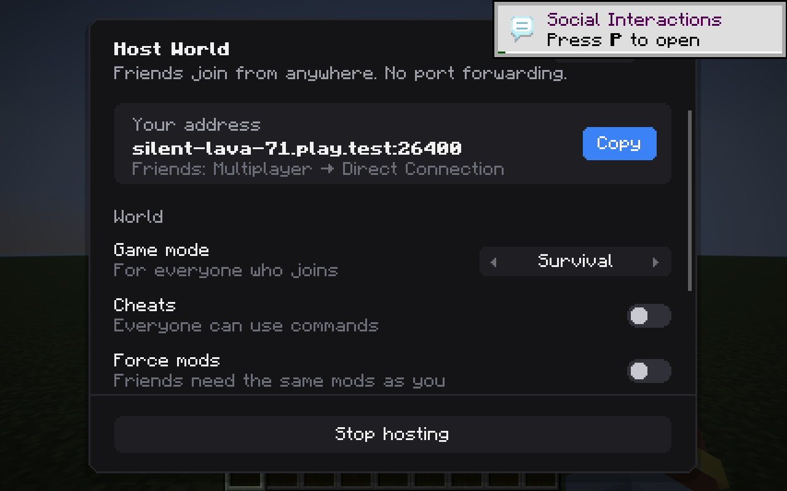
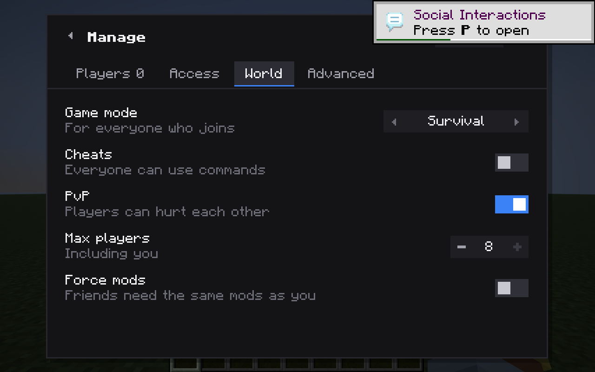

# Vibey Multiplayer

**Host your singleplayer world for friends anywhere. One fixed address, no port forwarding, no server.**

A client mod for Fabric and NeoForge by Vibe Craft Studios. Open your world from the pause menu, copy your address,
send it to your friends. They join with a normal, unmodded Minecraft through *Multiplayer → Direct Connection*.


## Features

- **Your own address.** Every player gets one address like `mossy-otter-27.axolite.cc`. It stays the same
  every time you host, in every world, until you decide to **renew** it (the old one stops working right away).
- **Host World** button in the pause menu, in place of *Open to LAN*. The window shows only your address, whether you
  are online and one button to start or stop.
- **Manage** opens the admin menu with four tabs:
  - **Players:** who is online, **OP** with one click, kick, ban; plus who was recently turned away (one click lets
    them in).
  - **Access:** a **whitelist** and a **ban list** (names and IPs). Both are enforced by the relay on **network level**:
    a blocked player never reaches your computer.
  - **World:** game mode for guests, cheats, PvP, max players, force mods.
  - **Advanced:** exact mod versions, new address, own relay server.
- **Force mods:** guests need Vibey and the same mods as you. Anyone who is missing something gets a clear list
  of what to install instead of a cryptic registry error.
- **Friends don't need the mod** (unless you turn on *Force mods*).
- End-to-end encrypted in online mode: the relay forwards bytes, it never sees inside the Minecraft connection.

| Hosting | Manage → Access |
|---|---|
|  |  |
| **Manage → Players** | **Manage → World** |
|  |  |

*Screenshots from the automated client test (Fabric 1.21.11, local test relay).*

## Supported versions

| Minecraft | Fabric | NeoForge |
|---|---|---|
| 1.21, 1.21.1 | ✔ | ✔ |
| 1.21.2, 1.21.3 | ✔ | ✔ |
| 1.21.4 | ✔ | ✔ |
| 1.21.5 | ✔ | ✔ |
| 1.21.6 – 1.21.8 | ✔ | ✔ |
| 1.21.9, 1.21.10 | ✔ | ✔ |
| 1.21.11 | ✔ | ✔ |
| 26.1, 26.2, 26.3 | ✔ | ✔ |

Fabric needs [Fabric API](https://modrinth.com/mod/fabric-api). The mod only runs on the client.

## How it works

```
 Friend (vanilla MC)            Relay (one TCP port)                 You (Minecraft + Vibey)
 ───────────────────            ────────────────────                 ───────────────────────
 connect mossy-otter-27… ──►   reads the host name from the   ◄──   control connection
                                Minecraft handshake, knocks          ("I own mossy-otter-27",
                                on your control connection           proven with your Mojang login)
                                                                ◄──   opens a data connection
                                splices both sockets          ──►   and glues it to 127.0.0.1:<LAN port>
                                                                     of your integrated server
```

- Your world is published like *Open to LAN*; Vibey connects that port to the relay. Nothing else on your
  computer is reachable.
- The relay proves who you are with the same Mojang session check servers use, so nobody can take your address.
- Addresses come from wildcard DNS (`*.axolite.cc`) pointing at the relay, so friends never type a port. Addresses
  handed out before the domain move keep working: `mossy-otter-27.vibey.henny.dev` is the same address.
- When you are offline, your address still answers in the server list: *"This world is offline"*.
- Whitelist and ban list travel to the relay. It reads the player name from the Minecraft *Login Start* packet and
  turns blocked players away with your message before opening a connection to you. Names cannot be faked: in online
  mode a player can only log in with an account they own. Bans by IP use the address the relay sees.

## Running the relay

The relay has no runtime dependencies (Node 23.6+ or Bun). Code, environment variables and the protocol are
described in [`relay/README.md`](relay/README.md).

1. Point a wildcard DNS record at your server: `*.play.example.com  A  <server IP>` (one per domain if you use
   several).
2. Start it:
   ```bash
   cd relay
   DOMAINS=play.example.com npm start      # several: DOMAINS=new.example.com,old.example.com (first = primary)
   # or: docker compose up -d   (edit DOMAINS in docker-compose.yml)
   ```
3. The mod connects to `relay.vibey.henny.dev:25565` by default (`default_relay` in
   [`gradle.properties`](gradle.properties)); the official relay is also `relay.axolite.cc`, the same server. Both
   names are covered by the wildcard records, and `relay` (like `www`, `api`, `status`) can never be handed out as an
   address. Players can point to another relay under *Advanced → Relay server*.

`npm test` in `relay/` runs an end-to-end test with a fake host and fake players.

### Live setup (Vibe Craft Studios)

- **Relay:** Dokploy project *Vibey Multiplayer*, compose *Relay* on the Hetzner server (public IP, TCP 25565, status
  on 8765), built from `relay/docker-compose.yml` of this repo.
- **Status API:** app *Status* on the home server behind Traefik + Cloudflare:
  `https://status.axolite.app/status` (formerly `vibey-status.henny.dev`, [`relay/status-proxy.ts`](relay/status-proxy.ts)).
  It exists because the relay itself cannot sit behind Cloudflare (raw TCP).
- **DNS:** `*.axolite.cc` and `*.vibey.henny.dev` must be **DNS-only** records (no Cloudflare proxy) pointing at the
  relay server. The relay runs with `DOMAINS=axolite.cc,vibey.henny.dev`: new addresses use `axolite.cc`, old ones keep
  working under both domains.

## Building

```bash
./gradlew buildAll          # every Fabric and NeoForge version, jars land in build/dist
./gradlew :fabric-1.21.11:runClient
```

Requires JDK 21 and JDK 25 (Minecraft 26.x). Multi-version builds use
[Stonecutter](https://stonecutter.kikugie.dev/): one source tree, version-specific lines are marked with
`//? if >=1.21.9` comments. Everything that differs between versions sits in `Compat.java`, `client/ui/Gfx.java`,
`client/ui/BaseScreen.java` and the two loader entry points. `./gradlew :fabric-1.21.11:runClientGameTest` starts the
real game, hosts a world through a local relay (`ALLOW_OFFLINE=1 HTTP_PORT=26401 PORT=26400 node relay/src/main.ts`)
and takes the screenshots above.

## Settings file

`config/vibey.json` holds the host settings (game mode, cheats, force mods, PvP, max players, whitelist, ban list,
relay, last address).

## License

**Code:** [Apache License 2.0](LICENSE), the mod as well as the relay server in `relay/`. You may fork, change and
share it. Releases published before 2026-11-18 stay under the MIT License they were released with.

**Not** covered by the code license (applies to all repositories of Vibe Craft Studios,
[LICENSING.md](https://github.com/vibec-studios/.github/blob/main/LICENSING.md)):

- **Names and logos** ("Vibey", "Vibey Multiplayer", "Vibe Craft Studios", the seal): forks need their own name, mod
  ID and logo – [TRADEMARKS.md](https://github.com/vibec-studios/.github/blob/main/TRADEMARKS.md).
- **Artwork** (icons, screenshots): all rights reserved – [ASSETS-POLICY.md](https://github.com/vibec-studios/.github/blob/main/ASSETS-POLICY.md);
  paths in [NOTICE](NOTICE).
- **Vibe services** (relay `axolite.cc` / `vibey.henny.dev`, backend `vibe.axolite.app` / `vibe.henny.dev`): official builds only –
  [SERVICES.md](https://github.com/vibec-studios/.github/blob/main/SERVICES.md). Forks must use a relay they run themselves.

Not an official Minecraft product. Not approved by or associated with Mojang or Microsoft.
